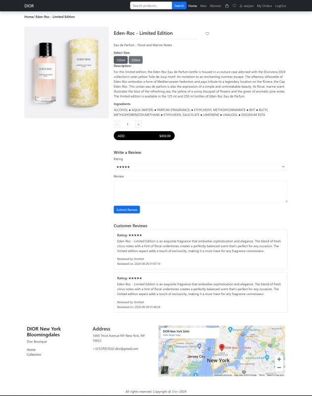
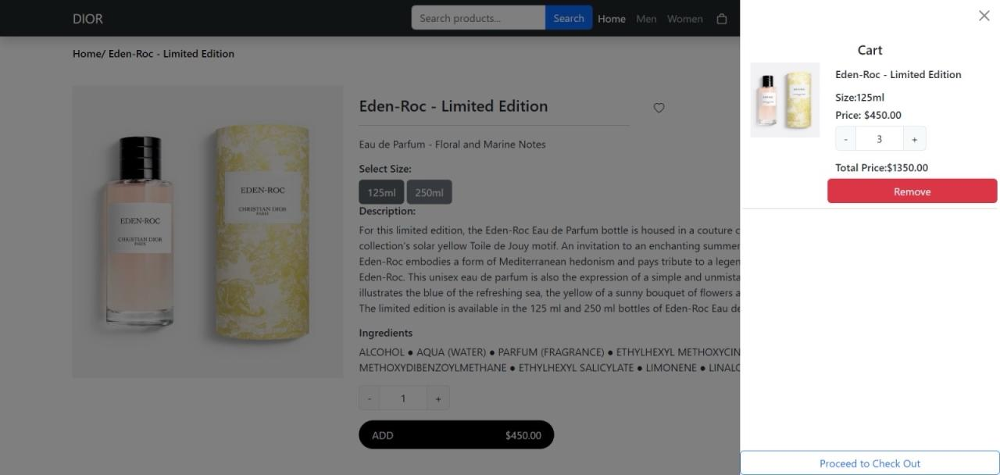
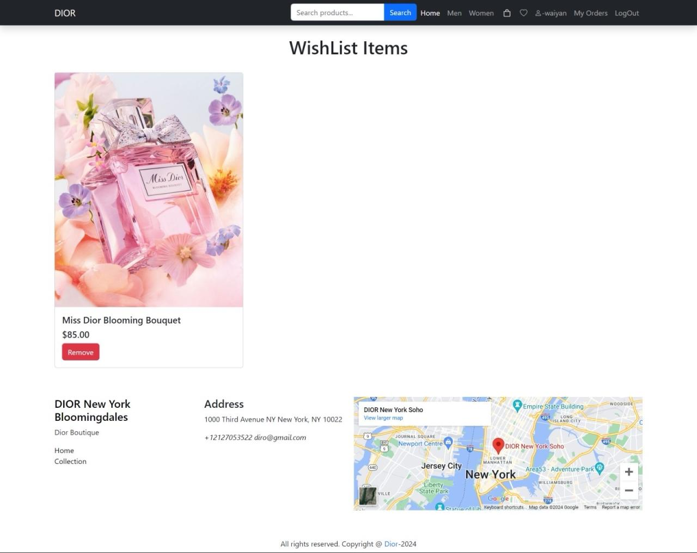

# DIOR E-Commerce Website

A full-stack e-commerce website for browsing and buying fragrances, built with PHP and MySQL. Customers can create an account, keep a wishlist, use a shopping cart and place orders. Administrators manage the collections, products, stock and orders from an admin panel.

*Student portfolio project, not affiliated with Dior.*

## Features

### Customer features

- Register and log in (passwords are stored securely with `password_hash`).
- Browse products by collection (Men, Women and a limited-edition collection).
- View product details: image, description, ingredients, size, price and stock.
- Save products to a wishlist, or remove them.
- Use a slide-out shopping cart to add products, change quantities and remove items. Quantities can't go above the stock available.
- Check out by entering contact and delivery details. The order total is calculated on the server.
- View past orders and their status (Under Process, Completed, Cancelled).

### Admin features

- Dashboard with revenue, orders waiting for action, product and customer counts, and low-stock alerts.
- Create, read, update and delete (CRUD) **collections** and **products**, including image uploads.
- Manage stock. Products with 0 stock show as "Out of stock" in the shop and can't be bought.
- View orders and change their status. Cancelling an order puts its items back in stock.
- Add other admin accounts (only a logged-in admin can do this).

## Technology

- PHP 8 (mysqli with prepared statements)
- MySQL / MariaDB
- HTML, CSS, Bootstrap 5 (shop) and a Bootstrap 4 admin theme
- JavaScript (Fetch API for the cart and wishlist)

## Run it locally

You need PHP 8.0 or newer and MySQL (or MariaDB). The easiest way on Windows is [XAMPP](https://www.apachefriends.org/), which includes both.

### 1. Get the code

```bash
git clone https://github.com/LinnHtet06/E-commerce.git
```

### 2. Create the database

Start **MySQL** from the XAMPP Control Panel, then import `database/dior_shop.sql`. Either:

- **phpMyAdmin:** open http://localhost/phpmyadmin, click **Import**, choose `database/dior_shop.sql`, click **Import**; or
- **command line:**

  ```bash
  mysql -u root < database/dior_shop.sql
  ```

  (on XAMPP the program is `C:\xampp\mysql\bin\mysql.exe`).

This creates a database called `dior_shop` with all the tables and some demo products. Importing it again resets everything to the demo state.

### 3. Start the website

**Option A: PHP's built-in server** (from the project folder):

```bash
php -S localhost:8000 -t cp
```

Then open http://localhost:8000.

**Option B: XAMPP's Apache:** copy the project folder into `C:\xampp\htdocs\`, start **Apache**, and open http://localhost/E-commerce/cp/.

### 4. Log in with the demo accounts

| Who | Where | Email | Password |
|---|---|---|---|
| Customer | http://localhost:8000/loginUi.php | `customer@example.com` | `customer123` |
| Admin | http://localhost:8000/admin/adminLogin.php | `admin@example.com` | `admin123` |

You can also register a new customer account from the **Register** link.

### Database settings

The connection settings are in `cp/db/config.php`. The defaults match a fresh XAMPP install (host `localhost`, user `root`, no password, database `dior_shop`). If yours are different, either edit that file or set the environment variables `DB_HOST`, `DB_PORT`, `DB_USER`, `DB_PASS` and `DB_NAME`.

## Project structure

```
cp/                    the website (point the web server here)
  index.php            home page with the collections
  product.php          products in one collection
  singleProduct.php    product details, add to cart / wishlist
  checkOut.php         checkout form
  myOrder.php, viewOrder.php, wishUi.php, loginUi.php, register.php
  include/             shared header, navbar, cart and footer
  functions/           login, cart, wishlist and order code + shared helpers
  admin/               admin panel (dashboard, products, collections, orders)
  upload/              product and collection images
  db/config.php        database connection
database/dior_shop.sql tables and demo data
```

## Screenshots

| Home | Product | Cart |
|---|---|---|
|  |  |  |

| Checkout | Wishlist |
|---|---|
|  |  |

## Security notes

- All database queries use prepared statements (no SQL injection).
- All user-supplied text is escaped before it is shown on a page (no cross-site scripting).
- Passwords are hashed with `password_hash()` / `password_verify()`.
- Every admin page and admin action checks that an admin is logged in.
- Uploads only accept real image files (JPG, PNG, GIF, WEBP).
- Checkout runs in a database transaction and re-checks stock, so an order is either saved completely or not at all.

The demo accounts above are for local testing only. Remove them or change their passwords before putting the site online.
